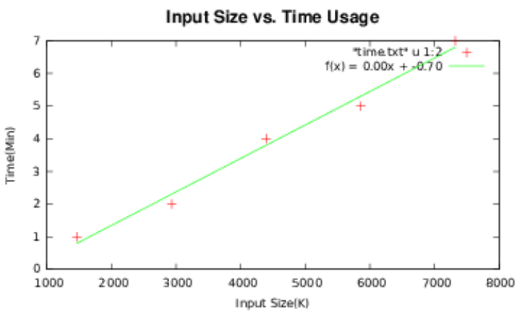
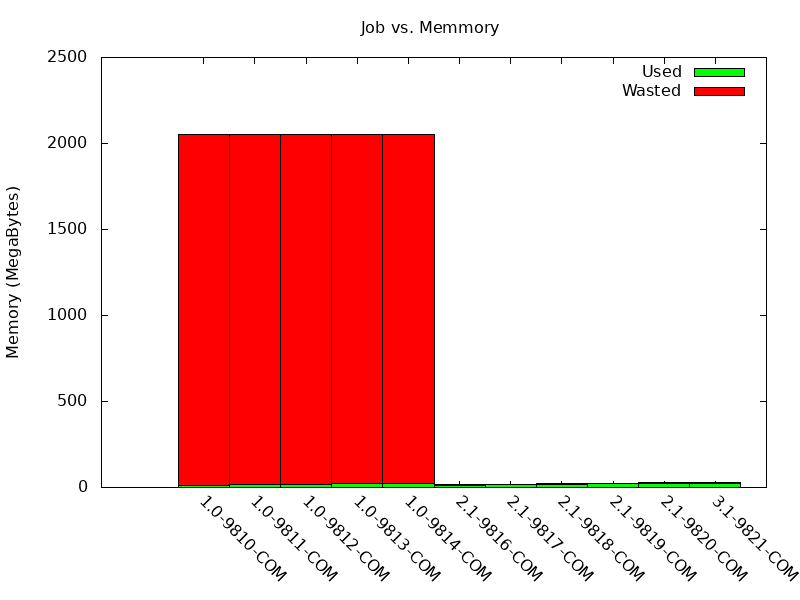
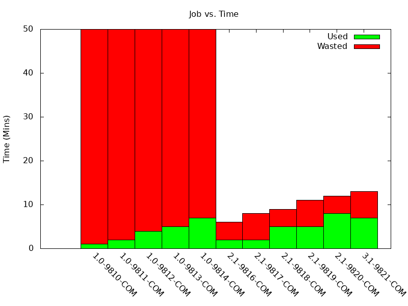
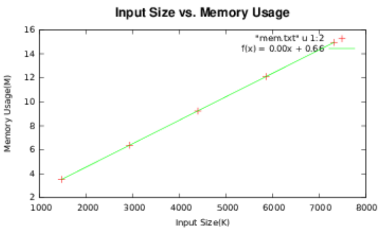

[&larr; SmartSlurm README](../README.md) &middot; [Docs index](README.md)

# Core concepts

## How a pipeline runs: convert and submit (two phases)

Understanding **when** each line runs is critical when adapting scripts to use `runAsPipeline`. Scripts are parsed in two phases.

```
                 ┌─────────────────────── PHASE 1: CONVERT (once, on submit host) ──────────────────────┐
  your_script.sh │ read top → bottom:                                                                    │
                 │   • for/while/#loopStart  → remember the loop variable (becomes part of each job flag) │
                 │   • #@ marker + body      → turn into an ssbatch call (--wrap, or a per-job cmd.sh)    │
                 │   • any other line         → copy through unchanged                                    │
                 └──────────────────────────────────────────┬───────────────────────────────────────────┘
                                                             ▼
                       smartSlurmLog/slurmPipeLine.<md5>.sh  (the "converted script")
                                                             │
                 ┌───────────────────────── PHASE 2: SUBMIT (run the converted script) ──────────────────┐
                 │   plain lines  → run right now, on the submit host                                     │
                 │   ssbatch call → SUBMIT a job, capture its ID; the command runs LATER, on a node,      │
                 │                  once dependencies (-d afterok:…) are satisfied.                        │
                 │                  Independent jobs beyond firstBatchCount(5) are submitted HELD (-H),    │
                 │                  then released after early jobs produce ≥3 records to estimate from.    │
                 └───────────────────────────────────────────────────────────────────────────────────────┘
```

**Phase 1 — Convert.** `runAsPipeline` reads your script once and writes a converted script named `smartSlurmLog/slurmPipeLine.<md5>.sh`. The `<md5>` is a hash of your script's contents, so re-running with an **unchanged** script skips reconversion and reuses the existing one.

**Phase 2 — Submit.** The converted script is executed top to bottom. Plain shell lines run **immediately, on the submit host**. Each `ssbatch` call **submits** a job and captures its ID — it does **not** run your command inline. Your command runs later, on a compute node, after its dependencies complete.

> [!WARNING]
> Because plain lines run at **submission time**, any shell logic that inspects a job's **output** runs *before that output exists*. The check below always prints `process`, never `skip`:
> ```bash
> for sample in sample1 sample2; do
>     #@1,0,process,,sample
>     process_sample.sh ${sample}.fq > ${sample}.result
>
>     # Runs during Phase 2 on the submit host — BEFORE job #@1 executes on a node.
>     # ${sample}.result does not exist yet, so this is always "process".
>     [ -f ${sample}.result ] && status=skip || status=process
>     echo "$sample: $status" >> summary.txt
> done
> ```
> **Fix:** move any logic that depends on a step's results into a *later* `#@` step, so it runs on a node after the upstream job finishes. The same rule governs an `if/else` that chooses which step to submit — the **condition must be evaluable at submission time** (from the input/manifest), not from a job's output.

> [!TIP]
> Functions you define in the plain part of the script are **not** automatically available inside `#@` job blocks (those run in separate jobs). Export them first: `export -f myfunction`.

## The `#@` job block

`runAsPipeline` turns an ordinary Bash script into a dependency-aware pipeline. You add `#@` comment markers above the commands you want submitted as Slurm jobs; everything else stays a normal shell command. Each marked step is submitted through `ssbatch`, so it inherits smart sizing, resubmission, and emails.

### Block fields

A **job block** is one `#@` annotation line plus the command line(s) that follow it:

```
#@ stepID , dependIDs , name , reference , inputs , sbatchOptions
<the command(s) to run for this step>
```

| Field | Meaning | Example | Required |
|-------|---------|---------|:--------:|
| `stepID` | Unique integer identifying the step. | `1`, `2` | **Yes** |
| `dependIDs` | `0` for no dependency, or upstream step IDs joined by dots. | `0`, `1`, `1.3` | **Yes** |
| `name` | Program/label; groups resource stats and names the job. | `findNumber` | **Yes** |
| `reference` | Reference file(s)/dir(s), dot-joined; synced to `/tmp` under `useTmp`. | `genome.fa`, `db1.db2` | No |
| `inputs` | Input file(s), dot-joined; size drives resource estimation. | `sample.fq`, `in1.in2` | No |
| `sbatchOptions` | sbatch options for this step. Omit to use the command-line default. | `sbatch -c 4 -t 2:0:0` | No |

> [!IMPORTANT]
> **Only the first three fields (`stepID`, `dependIDs`, `name`) are required.** `reference`, `inputs`, and `sbatchOptions` may be left empty — just keep the commas as placeholders.

**Examples**

```bash
# Step 1, no dependency, program "findNumber", input $input, explicit resources:
#@1,0,findNumber,,input,sbatch -p short -c 1 --mem 4G -t 50:0
findNumber.sh 1234 $input > $number.$i.txt

# Step 2 depends on step 1; no reference, no input, no sbatch options
# (uses the command-line default sbatch string):
#@2,1,mergeNumber,,,
cat $number.*.txt > all$number.txt

# Step 4 depends on steps 1 AND 3; one reference to sync, one input, custom resources:
#@4,1.3,map,genome.fa,reads.fq,sbatch -p short -c 4 -t 2:0:0
map.sh genome.fa reads.fq > out.bam
```

> [!TIP]
> Every step's `stepID` must be unique, or the run aborts. In an `if/else` where a step exists in both branches, give the two branches **distinct** step IDs — reusing one ID across branches drops the second branch.

### Closing a block: `#@end` vs blank line

A block needs a clear end so the parser knows which lines belong to the job. There are **two ways**, and a pipeline uses one mode throughout (chosen automatically).

**Explicit `#@end` (recommended).** Close the block with a line containing exactly `#@end`. The body between the marker and `#@end` is written **verbatim** to a per-job script (`smartSlurmLog/jobs/<flag>/cmd.sh`) and that file is submitted:

```bash
#@3,2,measure,,in,sbatch -p short -c 1 --mem 100M -t 5:00
# any awk, quotes, multi-line, heredocs, and command substitution survive intact:
awk '{ print length(\$1)"\t"\$1 }' tokens.$s.txt | sort -k1,1nr -k2,2 > measured.$s.txt
#@end
```

Because the body isn't flattened into a `--wrap` string, this is the robust choice for anything beyond a trivial one-liner. **If a pipeline uses `#@end` anywhere, it is in explicit mode: blank lines are ordinary body, and *only* `#@end` closes a block.**

Two escaping rules apply to the body of an `#@end` block:

- A `$` that must reach the **tool** literally (an `awk` field like `$1`, a `perl` `$_`) must be written **`\$`** — otherwise it is read as the pipeline's own shell variable. (See the `\$1` in the example above.)
- A variable **assigned inside the block** expands on the node; a variable from **submit scope** (including the loop variable) is baked in at submission. See [Passing files and variables between steps](#passing-files-and-variables-between-steps-scopes).

> [!TIP]
> Avoid a `for`/`while` loop *inside* a block body — a loop variable assigned inside a block isn't recognized as node-scope. Use explicit names, or put the loop in submit scope wrapping the `#@` block (that's how fan-out works; see [Loops](#loops)).

**Legacy blank-line close.** If a pipeline contains **no** `#@end`, blocks close the old way: a `#@` block collects every following line into one command and keeps going until it reaches a **blank line** (empty or all-whitespace). The block is flattened into a single `--wrap` string.

> [!IMPORTANT]
> In legacy mode a **blank line is the only thing that ends a block** — leave one before a `done`, the next `#@`, or any following plain command, or it gets swept into the previous job's command.

How each kind of comment is treated **in legacy mode**:

| Comment style | Ends the block? | In the job command? | Notes |
|---|:---:|---|---|
| Full-line `# comment` | No | No | Passed through to the converted script, but not part of the job's command. |
| Trailing `code # comment` | No | Only the `code` before ` #` | Everything from the first space-`#` to end of line is stripped. |
| Heredoc `: << EOF … EOF` | No | Mangled | **Not supported in legacy mode** — flattened into the command and breaks the block. Use `#@end` if you need a heredoc. |
| **Blank line** | **Yes** | n/a | The intended, and only, way to close a legacy block. |

> [!WARNING]
> Legacy inline-comment stripping is **textual, not shell-aware**: everything from the first space-`#` (` #`) to end of line is removed. Avoid a literal space-`#` inside a legacy command — *even inside quotes* — or it is truncated (e.g. `sed 's/ #/x/'` becomes `sed 's/`). A `#` with no space before it (`grep '#'`) is safe. The legacy `--wrap` flattener also **collapses quoted whitespace** (e.g. `tr -s ' '` loses its argument). Both problems disappear with `#@end`, which writes the body verbatim — prefer `#@end` for any non-trivial body.

## Passing files and variables between steps (scopes)

Every runAsPipeline script has **two scopes**. Knowing which one a variable lives in tells you exactly *when* it is evaluated and *who* can see it.

| Scope | What lives here | When it runs | Who can see it |
|-------|-----------------|--------------|----------------|
| **Submit scope** | Every plain line, including variable assignments *outside* any `#@` block | Once, on the submit host, during submission ([Phase 2](#how-a-pipeline-runs-convert-and-submit-two-phases)) | Later plain lines, the `reference`/`inputs`/`sbatch` fields of markers, and the command text of *every* `#@` block (substituted at submission) |
| **Node scope** | Code *inside* a `#@` block | Later, on a compute node, when the job runs | Only that one job |

The rule for when a `$var` is expanded:

> [!IMPORTANT]
> - A `$var` **used in a `#@` block but assigned in submit scope** is substituted with its value **at submission time** — the literal value is baked into the job's command before it goes to a node.
> - A `$var` **both assigned and used inside the same `#@` block** is left alone and expands **on the node at run time** (runAsPipeline sees the in-block assignment and defers it).
> - A variable assigned inside a `#@` block **exists nowhere else** — not in submit scope, not in other jobs.

**Data crosses between steps through files, not variables.** Because each job runs in its own node scope, you cannot hand a value from one job to the next through a shell variable. Steps communicate through **files on shared storage**:

1. Name the output path once, as a **plain variable in submit scope**.
2. The **producer** step writes to that path; the **consumer** step reads from it.
3. Declare the dependency in the consumer's marker so it waits for the producer.

The same submit-scope variable is substituted into both commands at submission, so both refer to the identical literal path — while the data itself flows through the filesystem, gated by the dependency:

```bash
mapInputR1=$outDir/fastq/$sampleName.1.noadap.fastq   # submit scope: name the file once
mapInputR2=$outDir/fastq/$sampleName.2.noadap.fastq

#@1,0,cutadaptSeqtk,,fileR1.fileR2,sbatch -c 4 -p short -t 3:0:0 --mem 12G
... ; seqtk trimfq -e 1 ...trim.paired.fastq > $mapInputR1; cp ... $mapInputR2   # producer writes the files

bowtieOut=$outDir/mapping/${refPrefix}_$genomeSpike.bam                          # submit scope: name step 3's output
refIndex=$bwtPath/${genomeRef}_$genomeSpike/${genomeRef}_$genomeSpike

#@3,1.2,bowtie2,refIndex,mapInputR1.mapInputR2,sbatch -c 6 -p short -t 2:00:0 --mem 24G
... bowtie2 ... -1 $mapInputR1 -2 $mapInputR2 ... | samtools sort ... -o $bowtieOut ...   # consumer reads the files
```

At submission `$mapInputR1` expands to the same path in step 1's and step 3's commands. Step 3 depends on steps 1 and 2 (`#@3,1.2,...`), so it is held until they finish — only then does the file exist, get measured, and step 3 get sized and released.

> [!NOTE]
> Listing a **produced** file as a downstream step's `inputs` is safe even though it doesn't exist at submission time. Dependent steps are submitted **held**, and their resource estimation is deferred until the upstream step completes and the file exists.

**Recommended convention: name paths in submit scope, next to the step.** Assign each step's input/output paths as plain variables **immediately above the `#@` marker that first uses them**. This gives one source of truth per path, keeps producer and consumer in agreement automatically, and reads top-to-bottom.

> [!WARNING]
> **Submit-scope variables persist across steps, branches, and loop iterations.** A value set for one step is still set when a later step is submitted, so a *missing* assignment silently reuses a stale value. Two habits prevent this:
> - Assign the variable on **every branch** that leads to a step using it.
> - Inside a **per-sample loop**, (re)assign paths **within the loop**, next to the step — not above the loop — or every iteration will submit jobs pointing at the first iteration's paths.

**Anti-patterns**

```bash
# ✗ Using a variable that was set inside a job block, from outside that block
#@1,0,stepA,,in
out=$outDir/result.bam; process.sh > $out     # 'out' lives only on step A's node
#@2,1,stepB,,in
summarize.sh $out                             # empty here: 'out' was never in submit scope
```
Fix: define `out` in submit scope (above `#@1`) so both steps see the same path.

```bash
# ✗ Reading a job's output during submission
producedByStep1=$outDir/a.bam
nReads=$(samtools view -c $producedByStep1)   # runs at SUBMISSION, before step 1 has made the file
#@2,1,stepB,,in
do_something.sh $nReads                        # $nReads is empty/garbage
```
Fix: move the `samtools view -c` **inside** step 2's block, where it runs on a node after step 1 completes.

## Loops

`runAsPipeline` preserves loop structure but extracts the `#@` blocks inside. **Every enclosing loop variable becomes part of each job's flag**, so per-iteration jobs get distinct names (e.g. `1.0.findNumber.1`, `1.0.findNumber.2`, …), and a **nested** loop (fan-out) stays collision-free (`4.3.countchunk.$sample.$chunk`).

**`for` loops** work directly — the variable right after `for` is detected automatically:

```bash
for file in `ls someFolder`; do
    #@1,0,process,,file
    process.sh $file
done
# each iteration submits a job flagged ...process.$file
```

**Fan-out / fan-in.** A nested `for` loop around a `#@` block submits one job per iteration (fan-out); a later step that depends on it waits for all of them (fan-in):

```bash
for c in 1 2 3; do
    #@4,3,countchunk,,in,sbatch -p short -c 1 --mem 100M -t 5:00
    wc -w < chunk.$s.$c > cc.$s.$c.txt      # 3 jobs: ...countchunk.$s.1/.2/.3
    #@end
done
#@5,4,merge,,in,sbatch -p short -c 1 --mem 100M -t 5:00
cat cc.$s.*.txt > merged.$s.txt             # depends on step 4 -> waits for all three
#@end
```

**Loops without a plain `for VAR` — give a hint.** A `while`/`until` header (or a C-style `for ((...))`) doesn't name its loop variable where the parser can read it, so declare it explicitly with `#loopStart:VAR` on the line above. This works for any loop construct:

```bash
#loopStart:f1
while read -r f1 f2 f3 f4; do
    #@1,0,process,,f1
    process.sh "$f1"
done < samples.txt
```

**How loop detection behaves (so it doesn't surprise you):**

- `for` and `done` are recognized only as the **first word** of a line, so an ordinary command whose name merely starts with those letters (`format…`, `foremost…`, `done_report…`) is never mistaken for a loop.
- A self-contained one-line `for … ; done` (one that wraps no `#@` step) is left alone.
- `#loopStart:VAR` must name a valid shell identifier; a malformed marker is ignored with a warning rather than producing a broken flag.
- If loops don't balance — a `for`/`#loopStart:` with no matching `done` — conversion **stops with a clear error** instead of silently corrupting job-flag names. Run `runAsPipeline --lint` to catch it without submitting.

## Resource estimation

For most programs, memory and run-time scale with input size. SmartSlurm records what resources prior jobs actually used, fits that relationship, and uses it to allocate resources for subsequent jobs. The fitting work is done by [`estimateResource.sh`](tools.md#under-the-hood-tools).

<em><b>Figure 1</b> — Memory usage tracks input size, so input size is a good proxy for allocating memory.</em>
<div align="center">

</div>

<em><b>Figure 2</b> — Early jobs run with the default memory; once enough have finished, ssbatch estimates memory for later jobs, sharply cutting wasted RAM.</em>
<div align="center">

</div>

<em><b>Figure 3</b> — The same for run-time: later jobs get much tighter time allocations.</em>
<div align="center">

</div>

Estimation has **two modes**:

- **Input size given (`-I`)** — ssbatch fits a straight line to *input size vs. memory* and *input size vs. time* using past records, and reads the estimate off the fit. Needs **≥3 records** to fit; below that, it uses the defaults.
- **No input size** — ssbatch takes the **90th percentile** of this program's past memory and time (so ~90% of jobs finish within the allocation). Also needs **≥3 records**; below that, defaults.

Fitted plots are written under `$smartSlurmJobRecordDir/stats/` for inspection:

<div align="center">


</div>

**How history is grouped for a fit.** Estimation **groups by `pipeline` + `step` + `ref`**, fitting **memUsed** and **timeUsed** against **inputSize** and using **status** to keep only validated (COMPLETED) history. The same program used by two different pipelines (e.g. default vs `--very-sensitive`, or two assays whose data differ in effort), or run against two references, builds separate fits instead of one blended one. Details that decide which rows share a fit:

- **`step` is the step *name*, not the step number.** It is the `runAsPipeline` step name (passed as `ssbatch -P`), which defaults to the command's first word when a step is left unnamed. `runAsPipeline` requires unique step *numbers* within a pipeline, but that number lives in the `flag` column, not in the grouping key — so two steps that share a step name **and** a ref would pool into one fit. Give each step a distinct name (or ref) and they stay separate; two genuinely identical steps are rare, and if intentional they usually *should* be modeled apart anyway.
- **Standalone jobs stay isolated.** An `ssbatch` run outside a pipeline carries `pipeline=unknown`, and with no `-R` carries `ref=none`; it forms its own group and never mixes into a pipeline's fit.
- **Missing values become sentinels, never blanks:** absent pipeline → `unknown`, absent ref → `none` (and `none` is never size-pooled).
- **Thin groups broaden only on the pipeline axis.** When a group has fewer than 3 points to fit, estimation falls back to pooling across *named* pipelines for the *same step + ref* only — it relaxes `pipeline`, never `step` or `ref` (e.g. right after migration, where old rows are `pipeline=legacy`, which do pool). Standalone `unknown` is the exception: it never pools into a pipeline's fit and is never broadened, so ad-hoc runs stay out of pipeline estimates (an `unknown` group regresses only on its own data).

> [!IMPORTANT]
> **`firstBatchCount` (5) and the "3 records" rule are different things.**
> - **3 records** is the minimum ssbatch needs before it can *estimate* resources for a program.
> - **`firstBatchCount=5`** is used only by `runAsPipeline`: it lets the first 5 independent jobs of a step run immediately, and submits the rest **held** (`-H`) until early jobs finish and produce records, then releases them with estimated resources.

### Partition selection

`ssbatch` (via `adjustPartition` in [`config.txt`](configuration.md#configtxt)) chooses a partition from the requested run-time using the `partitionNTimeLimit` values. If you pass `-p` yourself and it doesn't fit the run-time, it is adjusted for you — so you generally don't need to specify `-p` at all.

### OOM / OOT auto-resubmit

When a job ends, [`cleanUp.sh`](tools.md#under-the-hood-tools) records its memory and time usage into `jobRecord.txt`. If the job **failed out-of-memory or out-of-time**, ssbatch resubmits it with **double** the memory or time, and clears the stored formula for that program/reference so later jobs re-learn from fresh data.

### Checkpointing

Optional. When enabled (the `checkpoint` mode in `runAsPipeline`, or a `.Checkpoint` program name), a long-running job is snapshotted before it would hit its memory/time limit and resubmitted to resume from the checkpoint, instead of restarting from scratch.

## jobRecords

A CSV of resource records for every job, one row per job, with a header line. Its location is set by `smartSlurmJobRecordDir` in [`config.txt`](configuration.md#configtxt) and defaults to `~/.smartSlurm/jobRecord.txt`. The schema is **named** — tools read columns by header name, not position — so the column order can evolve without breaking readers. (The schema is defined in exactly one place, [`jobRecordSchema.sh`](tools.md#under-the-hood-tools).)

```text
pipeline,step,ref,sample,jobID,inputSize,memUsed,memAllocated,timeUsed,timeAllocated,cores,status,user,node,epoch,isoDate,flag
```

| Col | Name | Col | Name | Col | Name |
|----:|------|----:|------|----:|------|
| 1 | **pipeline** ⭐ | 7 | **memUsed** ⭐ | 13 | user |
| 2 | **step** ⭐ | 8 | memAllocated | 14 | node |
| 3 | **ref** ⭐ | 9 | **timeUsed** ⭐ | 15 | epoch |
| 4 | sample | 10 | timeAllocated | 16 | isoDate |
| 5 | jobID | 11 | cores | 17 | flag |
| 6 | **inputSize** ⭐ | 12 | **status** ⭐ | | |

<sub>⭐ = used directly by resource estimation. `pipeline` comes from `runAsPipeline --pipeline NAME` (default: the pipeline-script basename); `sample` and `flag` identify the per-sample job; `node`/`epoch`/`isoDate` are provenance.</sub>

The **pipeline** of a step is set with `runAsPipeline --pipeline NAME` (or defaults to the script's basename). Refs of similar size can optionally be **pooled** so their history combines — see `JR_REF_CLASS` (default pools the common mouse/human genomes `mm*`/`hg*`/`GRC*`; set it to `""` to disable).

Example rows:

```text
rnaseq,findNumber,none,,46531,1465,3,2048,1,120,1,COMPLETED,ld32,node01,1719830400,2024-07-01T10:00:00,1.0.findNumber
rnaseq,findNumber,none,,46535,2930,6,2048,2,120,1,COMPLETED,ld32,node01,1719830700,2024-07-01T10:05:00,1.0.findNumber
rnaseq,findNumber,none,,46534,4395,9,2048,4,120,1,COMPLETED,ld32,node02,1719831000,2024-07-01T10:10:00,1.0.findNumber
```

> [!IMPORTANT]
> **Upgrading from the old format.** Earlier SmartSlurm wrote a different, position-based `jobRecord.txt`. The tools read both, but to convert an existing store to the current schema once (recommended), run [`jrRepair.sh`](tools.md#under-the-hood-tools):
> ```bash
> jrRepair.sh            # converts the records in $smartSlurmJobRecordDir in place
> jrRepair.sh --dry-run  # preview only, writes nothing
> jrRepair.sh --check    # health report only (schema + row census); writes nothing
> ```
> It backs the original up to `jobRecord.back.<timestamp>.txt` (your rollback) before rewriting. Old rows carry no pipeline id, so they are tagged `pipeline=legacy`; new runs tagged with a real pipeline fall back to pooling that history until they accumulate their own.

## Notifications (emails)

Slurm's own email is only a subject line. SmartSlurm instead sends **consolidated, text-only** notifications, so a many-sample pipeline no longer floods your inbox (and no longer litters `smartSlurmLog` with per-job plot pngs):

- **Per sample** — one **warning** the first time a step in that sample fails (telling you to re-run the same command), and one **confirmation** when the sample's last step completes.
- **Per run** — a single **efficiency summary** when the whole run finishes successfully, carrying the per-sample [efficiency](monitoring.md#resource-efficiency) table and pointing you to `checkRun` (press `e`) for the per-step breakdown.

Auto-requeues (OOM/OOT resizing) are silent — they're in-progress recovery, reported by the summaries and `checkRun`. Use `--email noSuccEmail` (failures only) or `--email noEmail` (none) to reduce volume further. The old per-job resource plots (the per-job/barchart gnuplot pngs and their CSVs) are no longer generated — efficiency now lives in `efficiency.tsv` and `checkRun` (press `e`), so nothing clutters `smartSlurmLog`.

---


---

[&larr; SmartSlurm README](../README.md) &middot; [Docs index](README.md)
